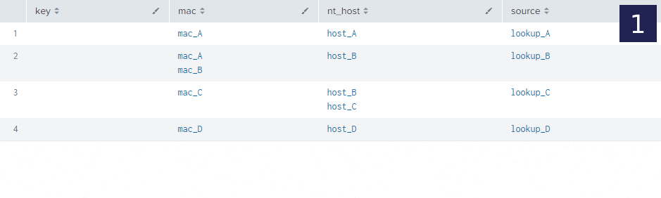

# AssetDB

AssetDB is a Splunk application that allows merging distinct data sources into an asset data base, without the need for Splunk Enterprise Security. The app is currently in beta and may be prone to bugs. 

## Usage

Navigate to the "Configure" tab to configure AssetDB

### Asset Lookups

Create lookup files and corresponding lookup generation searches for each unique data source that provides asset information. 

 - **Add lookup file**: Click the *Add Lookup* button to add a lookup file to be used to populate the merged *Asset Database*. A demo lookup file, *assetdb_demo_assets.csv* is provided by default. 

 - **Delete lookup file**: Click the *Delete* link next to an existing lookup file in the *Lookups Table* to remove the lookup and prevent its contents from being merged into the *Asset Database*.

### Asset Fields

Create fields to be stored within the *Asset Database* and merged between all input lookup files. 

Every merged asset also gets `last_seen`: the most recent `_time` of the source rows (empty when the source lookups have no `_time` column). Existing installs pick the field up in the `assetdb` lookup definition the next time a field is added or deleted in the UI.
Every key field gets an index in the KV store collection (the collection allows 10 indexes, `asset` uses one, so at most 9 key fields are indexed). The **Settings** tab holds global settings, including the default case rule and default normalizer for fields that do not set their own. `Max Keys` (stored as `max_keys` in the `[general]` stanza, default 25, hard limit 100) is the largest merged asset: assets whose merged key set is larger are dropped and counted in `python.log`. The limit is hard because the merge command keeps every key set in memory. The tab also sets the cron schedule of the merge search and whether it is scheduled.
Source lookups are read with the `input_adb_lookup` macro, which sets `source_lookup` to the lookup name when the lookup has no `source_lookup` column (lookups written by `output_adb_lookup` already carry it). `source` is derived from `source_lookup`.

- **Add field**: Click the *Add Field* button to add a new field into the *Asset Database*. See the **Field Properties** section below for more information on field properties. 

- **Edit field**: Click the *Edit Field* button to edit an existing field into the *Asset Database*. See the **Field Properties** section below for more information on field properties. 

- **Delete field**: Click the *Delete Field* button to delete an existing field from the *Asset Database*. Deleting a field, does not remove that field from any underlying lookup files. 

### Field Properties

The following field properties can be set when adding a new field or editing an existing field. 

| Property | Description |
| ----------- | ----------- |
| Field Name | The name of the field. Must consist of alphanumeric characters or underscores. Field names *_key* and *asset* are automatically created during the asset merge process and cannot be overwritten. |
| Key Field | Whether the field is a key field or not. Key fields are fields that define a unique asset and are used during the asset merge process. See **How AssetDB Merges Assets** for more information on. |
| Case Sensitive | Whether the field is case sensitive or not. A value of *No* will set all field values to lower case. |
| Keep Original Case | (Key fields only, when Case Sensitive is *No*) Store the original value and lowercase it only for matching assets, so `HOST-A` is displayed as written. Values that differ only by case are then both kept. |
| Normalizer | Rewrites every value into a canonical form before matching and merging: trim, MAC (`aa:bb:cc:dd:ee:ff`), IP (trim, no leading zeros), short host name, FQDN, user name (strips `DOMAIN\` and `@domain`), email, operating system family. *Default* uses the global default from Settings. The presets are the `normalize_*` macros. |
| Validate As | Drops values that are not of the chosen type (IP, IPv4, IPv6, MAC, email, host name, FQDN, CIDR, number) after normalizing. Assets are kept; only the invalid values go. |
| Description | Free text documenting what the field means. |
| Ignore Values | (Optional) A comma separated list of field values to ignore (e.g. null,none,unknown). |
| Fill Null | (Optional) A static value for assets that have no value for this field in any source (e.g. a default asset priority). Applied after the merge, so it never competes with real values. Not allowed on key fields. | 
| Validation | (Optional) A regular expression to validate field values. Values that fail validation are ignored. Case insensitive fields are lowercased first, so write the regex for lowercase values. | 
| Field Type | Defines the type of field. Use a single value, or keep all unique entries as a multivalue. |
| Merge Method | (Only applicable when Field Type is *Single*) Defines how a single value is derived across the input lookup table files. - **Latest**: the most recent value - **Min**: minimum value, only applicable to numeric field values - **Max**: maximum value, only applicable to numeric field values - **Avg**: average value, only applicable to numeric field values - **Coalesce**: define a precedence by ranking the source data with the *Coalesce* property |
| Coalesce | (Only applicable when Merge Method is *Coalesce*) Defines the precedence of source data to be used for this field. |
| Max Values | (Only applicable when Field Type is *Multivalue*) The maximum values the multivalue field can have (1 to 100). Excess values are trimmed, keeping the most recent values (by the `_time` of the source rows) unless Value Order is *Alphabetical*. Large multivalue fields can lead to reduced performance. 
| Value Type | (Single value fields) The type declared for the field in the KV store collection: text, number, true/false, time or CIDR. |
| Eval Expression | (Optional) An SPL eval expression applied to the field before merging, e.g. `replace(field1, "[^w]", "")`. Pipes, backticks and square brackets are only allowed inside quoted strings. |

### How AssetDB Merges Assets

AssetDB uses *Key Fields* to merge assets together into a single *Asset Database*. The below is an example of how the merge process operates, across 4 input lookup files, where *mac* and *nt_host* are defined as key fields. All fields are of Field Type *Mutivalue*.

1. Lookup files are concatenated together
2. A key is generated, composed of all *Key Field* values
3. Asset from `lookup_A` and Asset from `lookup_B` share a key `mac_A`
4. Asset from `lookup_A` and Asset from `lookup_B` are merged
5. The newly merged Asset and Asset from `lookup_C` share a key `host_B`
6. The newly merged Asset and Asset from `lookup_C` are merged. 
7. The Asset from `lookup_D` does not share keys with any other asset. It is not merged. 

Note how although, the Asset from `lookup_A` and Asset from `lookup_C` do not share any keys, they end up being merged due to both sharing keys with the Asset from `lookup_B`.

### Asset Merge Search

Merging is done via a custom command `adbmerge` and saved search `assetdb-lookupgen` that runs on a user defined frequency. By default, this frequency is once a day. The saved search is automatically updated based on *Lookup* and *Field* configurations. Merged assets are outputted to the `assetdb` KV store. 

### Operational notes

- **Rewrite window.** The merge search ends with `outputlookup assetdb`, which replaces the collection. Measured on Splunk 10.4.2 with a 45,000 row collection rewritten in about 2 seconds while six readers polled it, roughly 1 in 70 reads returned no results during a rewrite. Searches that use `| lookup assetdb` during the nightly run (default `0 0 * * *`, with a 60 minute schedule window) can therefore miss matches briefly. Schedule the search outside the hours that matter.
- **Read limit.** `| inputlookup assetdb` returns at most `max_rows_per_query` rows (50,000 by default, `limits.conf` `[kvstore]`). Raise it if you list the whole collection; `| lookup assetdb ...` is not affected.
- **Splunk versions.** The `adbmerge` command runs on Python 3.13 (`python.required = 3.13`, splunk-sdk 3.x), so it needs a Splunk version that provides it (tested on 10.4.2); Splunk 10.0 runs commands on Python 3.9 and is not supported.

## Testing

Unit tests, packaging, AppInspect, deployment to a dev server and integration tests are described in [docs/TESTING.md](docs/TESTING.md). Quick start: `make test`, `make package`, `make inspect`.
