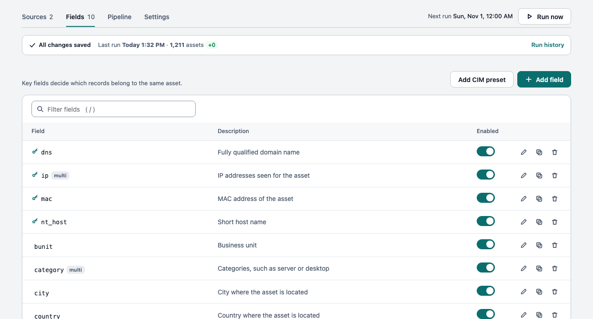
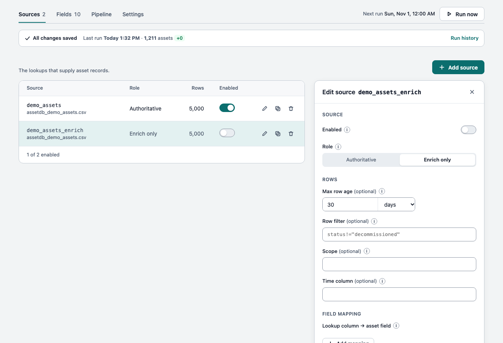
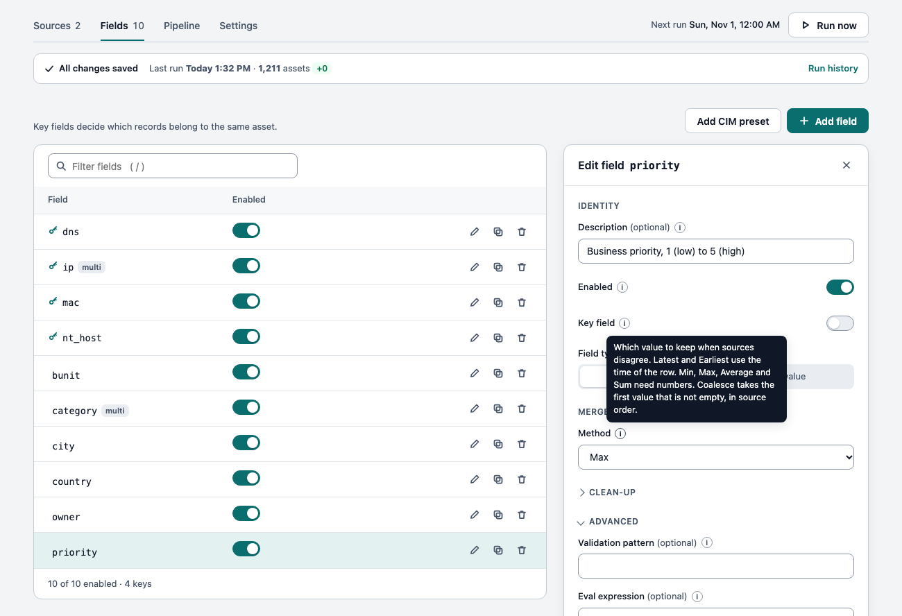
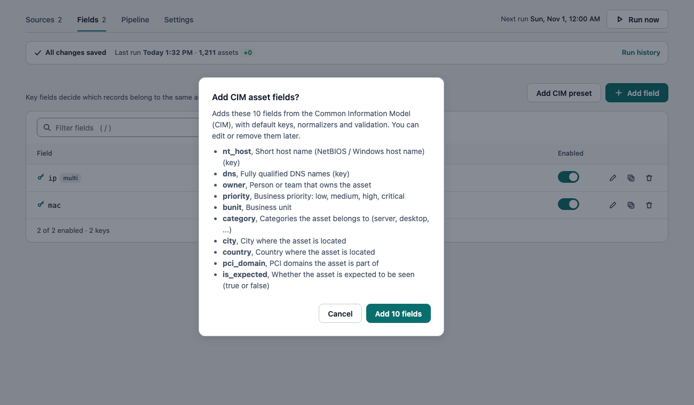
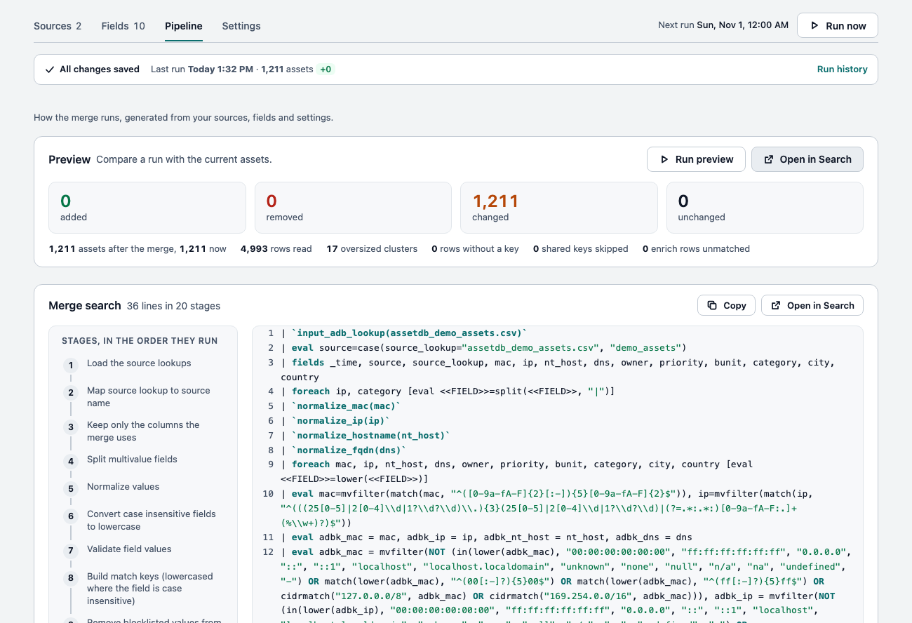
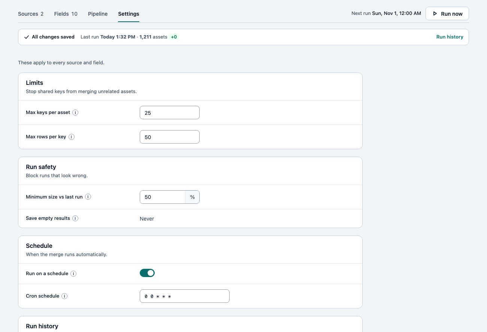
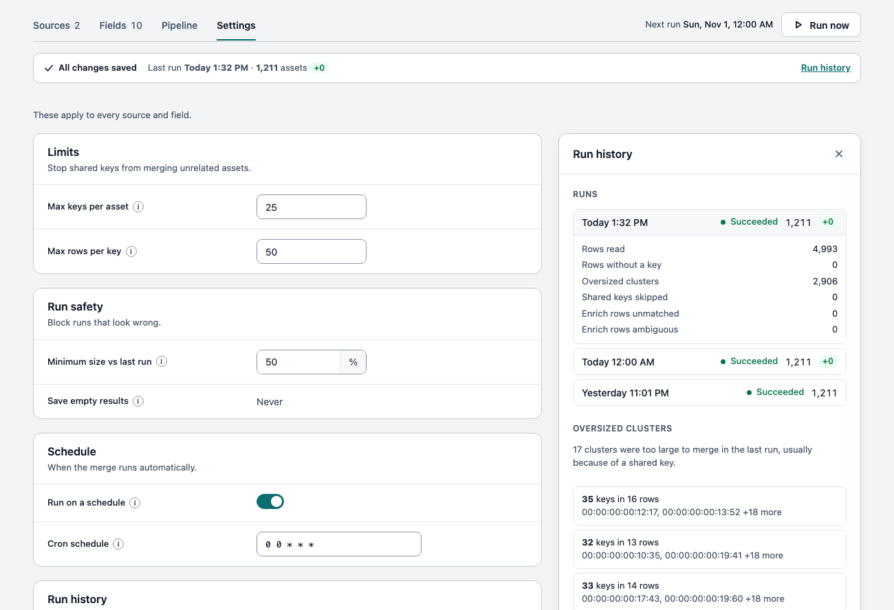

# AssetDB

AssetDB combines asset records from several lookups into one list of assets. Records that share an identifier, such as a MAC address, an IP address or a host name, become one asset, and their fields are merged. You can search the result and use it to add asset details to your events. It does not need Splunk Enterprise Security.



## Requirements

- Splunk Enterprise 10.2 or later. The icons in the app navigation need 10.4 or later (on 10.2 the navigation shows letters instead).
- The app follows your Splunk theme (light or dark): see [Themes](#themes).
- The KV store must be running.
- To change the configuration you need the `admin` role. Anyone who can read the app can search the asset list.

## Installation

1. In Splunk Web, open **Apps > Manage Apps > Install app from file** and upload `assetdb-<version>.tar.gz`. Or extract it into `$SPLUNK_HOME/etc/apps/`. In a search head cluster, install it from the deployer.
2. Restart Splunk if asked.
3. Open **AssetDB**. The Configure page is the home page of the app.

Upgrading from 1.5.7 or earlier? Read the [breaking changes](#breaking-changes-in-160) first.

## Quick start

1. **Add a source.** On the **Sources** tab, click *Add source* and choose a lookup. The demo lookup `assetdb_demo_assets.csv` is already there. To build lookups from your own data, see [Source templates](#source-templates).
2. **Add fields.** On the **Fields** tab, click *Add CIM preset* to add the common asset fields (`mac`, `ip`, `nt_host`, `dns`, `owner` and more), or click *Add field*. Mark the fields that identify an asset as **key fields**.
3. **Preview.** On the **Pipeline** tab, click *Run preview*. It shows how many assets a run would add, remove or change, and saves nothing.
4. **Run.** Click *Run now*, or wait for the schedule (every day at midnight by default).
5. **Use the result.** Open **Explorer** to search the assets and see where each value came from, search `| inputlookup assetdb`, or add asset details to events with `` `adb_enrich(src_ip)` ``. See [Explorer and Coverage](#explorer-and-coverage) and [Using the asset list](#using-the-asset-list).

## How assets are merged

AssetDB treats records that share a key value as the same asset. Say one laptop appears in three systems, and each knows something different. `mac` and `nt_host` are key fields. `ip` can hold several values and `owner` holds one:

| Source | mac | nt_host | ip | owner |
| --- | --- | --- | --- | --- |
| cmdb | aa:bb:cc:00:00:01 | LAPTOP-7 | | dana |
| dhcp | aa:bb:cc:00:00:01 | | 10.1.1.20 | |
| edr | | laptop-7 | 10.1.1.31 | |
| cmdb | aa:bb:cc:00:00:02 | SRV-DB | | ops |

1. The first `cmdb` row and the `dhcp` row share a MAC address, so they are the same asset.
2. The `edr` row shares the host name with the first `cmdb` row (case is ignored), so it joins too. It has nothing in common with the `dhcp` row, but both match the `cmdb` row.
3. The last row shares nothing with the others, so it is a separate asset.

The result is two assets. Each field has one value, or all unique values if the field can hold several:

| mac | nt_host | ip | owner |
| --- | --- | --- | --- |
| aa:bb:cc:00:00:01 | laptop-7 | 10.1.1.20, 10.1.1.31 | dana |
| aa:bb:cc:00:00:02 | srv-db | | ops |

Linking is chained: a record joins an asset if it shares a key with any record already in it. That is why one bad key, such as an address shared by many devices, can pull unrelated assets together. See [Key quality](#key-quality). When sources disagree on a single-value field, the field's *Method* decides which value is kept (the most recent by default).

### Scoped keys

The same address can exist in two sites (overlapping private ranges, an acquired network, one tenant per customer), and those records must not merge. Give each source a **Scope**, or choose a **Scope column** in Settings. Then mark key fields that are only unique within a site, such as IP addresses and host names, as **Scoped**. Keep globally unique ones, such as MAC addresses and serial numbers, as **Global**. A scoped key only matches records with the same scope. Turning on scoping changes the keys, so the first run after it rebuilds the asset list.

### Key quality

One bad key can chain unrelated assets into one huge group. Three settings guard against it, all on by default (see [Settings](#settings)): the **key blocklist**, **Max rows per key** and **Max keys per asset**. Records left without any key are dropped.

## The Configure page

The page has four tabs and a status strip.

- **Edits are saved with *Save*.** The editor next to a table holds your changes. Nothing is written until you click *Save*, and closing with unsaved changes asks first. If a step of a save fails, the status strip says which one and offers a retry.
- **Tables are read-only.** Each row has an *Enabled* switch (it saves right away) and *Edit*, *Duplicate* and *Remove* icons.
- **Warning icons** next to a name explain a problem, such as a lookup that cannot be read or a field that no enabled source provides. Click *N items need attention* in the status strip to show only those rows.
- **Help** for each setting is in the (i) tooltip next to its label.
- The **status strip** shows whether everything is saved, the last run and the next scheduled run, with *Run now* and *Run history*.

### Sources



A source is a lookup that provides asset records. *Remove* takes a source out of the merge; the lookup itself is not deleted.

| Option | What it does |
| --- | --- |
| Name | A friendly name, such as `Active Directory (prod)`. Spaces and punctuation are fine; up to 64 characters, without quotes, backslashes, commas or backticks. It is what the Explorer and Coverage show. It cannot be changed later. |
| Enabled | A disabled source is left out of the merge but keeps its settings. |
| Role | *Authoritative* sources create assets. *Enrich only* sources (a vulnerability scanner, for example) only add data to assets that already exist. A record is added only if it matches exactly one asset; otherwise it is dropped and counted. |
| Max row age | Ignore rows older than this. Rows without a time are kept. |
| Row filter | Keep only rows where this `where` expression is true, for example `status!="decommissioned"`. |
| Scope | The site or tenant of every row in this source. See [Scoped keys](#scoped-keys). |
| Time column | The column that holds each row's time (in epoch seconds), if it is not `_time`. |
| Field mapping | Maps a lookup column to an asset field when the names differ, for example `Computer Name` to `nt_host`. |

### Fields



A field is a piece of information you want on each asset. *Add CIM preset* adds the standard asset fields in one step: `mac`, `ip`, `nt_host` and `dns` (keys), plus `owner`, `priority`, `bunit`, `category`, `city`, `country`, `pci_domain` and `is_expected`. Fields you already have are left alone. You do not need the CIM add-on or Enterprise Security.



Every asset also gets `source`, `source_lookup`, `last_seen` (the latest `_time` of its rows), `scope` and `conflicts`. These names are reserved, as are `_key` and `asset`.

| Property | What it does |
| --- | --- |
| Name | Letters, digits and underscores, starting with a letter or underscore. It cannot be changed later. |
| Description | Notes for people. It does not affect the merge. |
| Enabled | A disabled field is left out of the merge but keeps its settings. |
| Key field | Records with the same value in a key field become one asset. Each key field is indexed for fast lookups. The KV store allows 10 indexes per collection and the app uses one, so at most 9 key fields are indexed. |
| Key scope | *Global* keys match everywhere. *Scoped* keys match only within the same scope. |
| Field type | *Single* keeps one value. *Multivalue* keeps every unique value. |
| Method | For single-value fields, which value wins when sources disagree: *Latest* or *Earliest* (by the row's `_time`), *Min*, *Max*, *Average* or *Sum* (for numbers; set Value type to Number), or *Coalesce* (the first value that is not empty, in the *Source order* you choose). |
| Case sensitive | When off, values match regardless of case and are stored in lowercase. |
| Keep original case | For case-insensitive key fields: store the value as written and ignore case only when matching. Not available with the host name, FQDN, user name, email and operating system normalizers, because they lowercase the value. |
| Normalizer | Puts values in a standard form before matching: trim spaces, MAC (`aa:bb:cc:dd:ee:ff`), IP (no leading zeros), short host name, fully qualified domain name, user name (removes `DOMAIN\` and `@domain`), email, operating system (the specific name, such as `ubuntu` or `windows_server`), or operating system family (`Windows Server`, `Windows Desktop`, `Linux`, `Mac`, `iOS`, `iPadOS`, `Android`, `Unix`, `Hypervisor`, `Network device`; anything else becomes `Other`). *Default* uses the choice in Settings. |
| Validate as | Drops values that are not of the chosen type (IP, IPv4, IPv6, MAC, email, host name, FQDN, CIDR, whole number, number). The asset stays; only the value goes. |
| Ignore values | Values to skip: an exact value, `re:<regular expression>` or `cidr:<network>`. For example `unknown`, `re:^169\.254\.` or `cidr:127.0.0.0/8`. |
| Use the global ignore list | Also skip the values on the global list in Settings. On by default. |
| Validation pattern | A regular expression. Values that do not match are dropped. |
| Eval expression | An SPL `eval` expression applied to the field before merging. Pipes, backticks and brackets are only allowed inside quoted text. |
| Fill null | A fixed value for assets that have no value in any source. Not allowed on key fields. |
| Value type | The type stored in the KV store: text, number, true/false, time or CIDR. |
| Flag conflicts | When sources disagree, add the field name to the asset's `conflicts` field so you can review it. Uses more memory. |
| Max values, Value order | For multivalue fields: the most values to keep (1 to 100), and which ones: *Most recent first* or *Alphabetical*. |
| Only accept values from | Take values for this field only from the listed sources. |

### Pipeline



**Preview.** *Run preview* runs the whole merge without saving anything and compares it with the current asset list. It shows how many assets would be *added*, *removed* or *changed* (including changes to values inside an asset) and how many stay *unchanged*. It also tells you if the safety check would block a real run. *Open in Search* opens the comparison in Search, with one row per asset. The preview does the same work as a real run, so it can take a while with many assets. In the screenshot every asset shows as changed because the existing asset list was built without these fields.

**Merge search.** The search that runs on the schedule and when you click *Run now*, shown one stage at a time in the order the stages run. It is rebuilt from your sources, fields and settings each time you save. To change how merging works, change the configuration. Edits to the saved search `assetdb-lookupgen` are overwritten.

### Settings



| Setting | What it does |
| --- | --- |
| Max keys per asset | The most keys one asset may have (default 25, at most 100). Bigger groups are not saved and are listed under *Oversized clusters* in Run history. They usually come from a shared key such as a NAT address. |
| Max rows per key | A key found in more rows than this (default 50, 0 turns it off) is not used for matching. |
| Minimum size vs last run | A run that produces fewer assets than this share (default 50%) of the last successful run is not saved and shows as *Blocked*. A run with no assets never replaces the asset list. |
| Run on a schedule, Cron schedule | When the merge runs automatically. The default is `0 0 * * *` (daily at midnight). |
| Runs to keep | How many runs the history keeps (default 200, at most 5000). |
| Default case sensitive, Default normalizer | Used by fields that do not set their own. |
| Scope column | A column in the source lookups that holds each row's scope, for sources without a scope of their own. |
| Key blocklist | Values that are never used for matching, in any key field. The defaults cover all-zero and broadcast MAC addresses, `0.0.0.0`, `::`, loopback and link-local addresses, `localhost`, and placeholders such as `unknown` and `n/a`. A blocked value stays on the asset; it just cannot link two assets. Saving replaces the defaults, so you can remove any of them. |
| Global ignore list | Values skipped in every field that uses the global list. |

### Run history



Each run is recorded with its time, status (`ok`, `blocked_low_count` or `empty`), the number of assets, and counts such as rows read, rows without a key and shared keys skipped. The *Run history* panel shows the latest runs and the oversized clusters of the last run. You can also search them:

```
| inputlookup assetdb_runs | sort 0 -run_time
| inputlookup assetdb_overflow
| inputlookup assetdb | search conflicts=*
```

To be told when a run is blocked, enable the saved search `assetdb-run-alert` and add an alert action to it.

## Explorer and Coverage

The app has two dashboards for looking at the result. They are in the app menu next to Configure.

**Explorer.** Type any key value, for example a host name or `10.4.*`, to find assets. `*` matches anything. The list shows the 100 most recently seen assets and says how many there are in all, so searching is how you reach the rest. Select an asset to see its keys and its fields. Click a key to copy it.

- Next to each field you see which sources supply the value that was kept. Sources are compared with each other: the most recently seen source is the one used, and a source that holds different values from it is shown in amber with `≠` (case, spacing and order are ignored, so copies of each other never differ, and neither does a single source). Click a field to compare the value of every source, with its last-seen date.
- Fields that no source filled in are folded away under *Show N fields with no value*.
- *N fields differ* lists the fields where sources disagreed. A source agrees when everything it holds is part of the final value, so one of several IPs is not a disagreement. Several records of the same source for one asset are not counted as sources disagreeing.

**Coverage.** A heatmap of how much of your estate each source covers. Pick a field in *Group by* (or leave it on *No grouping*), and each cell shows the share of the assets in that group that a source contributed to. Click a cell to open a search in a new window that lists the assets of that group and whether that source covers each one. Use the legend handles to fade cells outside a range, and click a column header to sort.

The names you give fields and sources are used as they are. Nothing else needs to be set up, except the optional icons below.

### Icons

Every asset in the Explorer has an icon, such as a server or a phone. The asset data does not say what kind of device an asset is, so by default every asset gets the generic **Other** icon, and you decide the rest with one macro: `adb_icon`. It is an eval statement that sets the field `adb_icon` from any of the asset's fields. The value must be one of **server, desktop, laptop, mobile, tablet, network, printer, iot, virtual, storage, cloud** or **other**; anything else gives the default icon. It ships as `eval adb_icon="other"`.

The **Settings** tab of the Configure page explains this and has an *Edit the adb_icon macro* link. You can also open **Settings > Advanced search > Search macros** in Splunk, find `adb_icon` in the AssetDB app and edit its definition, for example:

```
eval adb_icon=case(match(mvjoin(category, " "), "(?i)printer"), "printer", match(mvjoin(os, " "), "(?i)windows server|linux"), "server", match(mvjoin(os, " "), "(?i)ios|android"), "mobile", true(), "other")
```

(`mvjoin` makes a multivalue field safe to match on.) A change shows the next time the Explorer runs its search. Another macro, `adb_provenance(<_key>)`, reads the sources for one asset on demand for the Explorer; the Configure page keeps it up to date.

## Themes

The Configure page and both dashboards are **dark by default**. If you chose the light theme in your Splunk user preferences, they switch to light: the app reads your preference and, when it is *light*, reloads the page once with `?theme=light` in the address (Splunk does not apply your theme to classic dashboards by itself). A page opened with `?theme=light` or `?theme=dark` in its address is left as it is, so you can use that to see either theme. A light-theme user sees the dark page for about half a second first: Splunk draws the page before any app code can run, and an app cannot prevent that.

## Using the asset list

Search all assets with `| inputlookup assetdb`. In a subsearch, use `| inputlookup append=true assetdb` instead of `append [| inputlookup assetdb]`, because subsearches stop at 50,000 results.

Add asset details to events with a macro. The macros are available in every app:

```
index=firewall | `adb_enrich(src_ip)`
index=dhcp | `adb_enrich_mac(client_mac)`
index=vpn | `adb_enrich_scoped(src_ip, site)`
```

| Macro | What it does |
| --- | --- |
| `adb_enrich(key)` | Finds the asset that has the value of the field `key` as one of its keys and adds `asset_id`, `asset_source`, `asset_source_lookup`, `asset_last_seen` and `asset_<field>` for each field. Fields already on the event are not overwritten. Matching ignores case. |
| `adb_enrich_mac(key)`, `adb_enrich_ip(key)`, `adb_enrich_host(key)` | The same, after putting the value in the standard MAC, IP or short host name form. `AABB.CCDD.EEFF` finds `aa:bb:cc:dd:ee:ff`. The original field is unchanged. |
| `adb_enrich_scoped(key, scope)` | For keys marked *Scoped*. Matches on the scope and the value. |
| `adb_enrich_with(key, lookup)` | Like `adb_enrich`, for a lookup other than `assetdb`. |

Other macros: `input_adb_lookup(lookup)` reads a source lookup (and sets `source_lookup` to its name, whatever a `source_lookup` column in the file says) and `output_adb_lookup(lookup)` writes one. `normalize_trim`, `normalize_mac`, `normalize_ip`, `normalize_hostname`, `normalize_fqdn`, `normalize_user`, `normalize_email`, `normalize_os` and `normalize_os_family` apply the normalizers and work on fields with several values.

## Source templates

The hardest part of setup is building the source lookups. The app includes saved searches, all disabled, that build a source lookup from the data a vendor's Splunk add-on indexes, using the field names of the CIM preset. To use one, install the add-on and collect its asset or device data, enable the saved search, run it once (it creates the lookup file), and add that lookup on the Sources tab. Each search names the sourcetype it reads, and uses the add-on's own macro or eventtype where it has one (set that macro to your index first). Adapt the search if your data differs: run `| fieldsummary` on the sourcetype to see the field names you have. Every search that groups by a vendor's own record ID also writes that ID as a field (for example `tenable_id`) that you can add on the Fields tab. None of them uses an external (NAT) address as a key.

| Saved search | What it builds | Needs | Add as |
| --- | --- | --- | --- |
| `assetdb-src-splunk-hosts` | Every host that sends data to Splunk | Nothing | Authoritative (host name only) |
| `assetdb-src-dhcp-cim` | IP, MAC and host name from DHCP events (CIM Network Sessions) | CIM add-on and a DHCP add-on | Authoritative, with a short max age |
| `assetdb-src-vulnerabilities-cim` | Vulnerability counts and highest CVSS score per host (CIM Vulnerabilities) | CIM add-on and a scanner add-on | Enrich only |
| `assetdb-src-ad-computers` | Enabled Active Directory computer accounts (last logon as the time, the manager as the owner; no IP or MAC) | [Splunk Supporting Add-on for Active Directory](https://splunkbase.splunk.com/app/1151) | Authoritative |
| `assetdb-src-defender-machines` | Devices from Microsoft Defender for Endpoint | Splunk Add-on for Microsoft Security | Authoritative |
| `assetdb-src-tenable-assets` | Assets from Tenable Vulnerability Management (terminated assets left out) | [Tenable Add-On for Splunk](https://splunkbase.splunk.com/app/4060/) | Authoritative, or Enrich only if another source owns the inventory |
| `assetdb-src-crowdstrike-devices` | Hosts from CrowdStrike Falcon (internal IP only; the Falcon device ID is the key) | [CrowdStrike Falcon Devices Add-on](https://splunkbase.splunk.com/app/5570) | Authoritative |
| `assetdb-src-servicenow-cmdb` | Servers and virtual machines of the CMDB (retired CIs left out) | [Splunk Add-on for ServiceNow](https://splunkbase.splunk.com/app/1928/) | Authoritative |
| `assetdb-src-qualys-vmdr-hosts` | Hosts Qualys VMDR scanned (adapt: the add-on does not list its columns) | [Qualys Universal TA](https://splunkbase.splunk.com/app/9110) | Enrich only |
| `assetdb-src-rapid7-insightvm` | Assets from InsightVM | [Rapid7 InsightVM Technology Add-On](https://splunkbase.splunk.com/app/5097/) | Authoritative, or Enrich only |
| `assetdb-src-armis-devices` | Devices Armis discovered (IoT, OT, unmanaged) | [Armis Add-On for Splunk](https://splunkbase.splunk.com/app/4872) | Authoritative |
| `assetdb-src-axonius-devices` | Devices of an Axonius saved query (adapt: the columns are the query's) | [Axonius Add-On for Splunk](https://splunkbase.splunk.com/app/5740) | Authoritative, on its own |
| `assetdb-src-lansweeper-assets` | Assets from Lansweeper, cloud or on premises | [Lansweeper Add-on for Splunk](https://splunkbase.splunk.com/app/5418/) | Authoritative |
| `assetdb-src-jamf-computers` | Mac computers from Jamf Pro (the section events of a computer joined on its ID) | [Jamf Pro Add-on](https://splunkbase.splunk.com/app/4729/) | Authoritative |
| `assetdb-src-aws-ec2-instances` | EC2 instances (terminated ones left out) | [Splunk Add-on for AWS](https://splunkbase.splunk.com/app/1876/) | Authoritative, with a short max age |
| `assetdb-src-sentinelone-agents` | Endpoints with a SentinelOne agent | [SentinelOne App for Splunk](https://splunkbase.splunk.com/app/5433) | Authoritative |
| `assetdb-src-tanium-inventory` | Endpoints from the Tanium asset question | [TA-Tanium](https://splunkbase.splunk.com/app/4439) | Authoritative |
| `assetdb-src-tanium-discover` | Interfaces Tanium Discover found, managed or not | [TA-Tanium](https://splunkbase.splunk.com/app/4439) | Authoritative, with a short max age |
| `assetdb-src-carbon-black-cloud-devices` | Endpoints of Carbon Black Cloud (deregistered ones left out) | [VMware Carbon Black Cloud App](https://splunkbase.splunk.com/app/5332) | Authoritative |
| `assetdb-src-azure-virtual-machines` | Azure VMs, with the address and MAC joined from their network interfaces | [Splunk Add-on for Microsoft Cloud Services](https://splunkbase.splunk.com/app/3110) | Authoritative, with a short max age |
| `assetdb-src-entra-devices` | Devices registered in Microsoft Entra ID (host name only) | [Splunk Add-on for Microsoft Azure](https://classic.splunkbase.splunk.com/app/3757) | Authoritative, or Enrich only |
| `assetdb-src-gcp-compute-instances` | Compute Engine instances from the asset inventory export | [Splunk Add-on for Google Cloud Platform](https://splunkbase.splunk.com/app/3088/) | Authoritative, with a short max age |
| `assetdb-src-cortex-xdr-endpoints` | Endpoints of Cortex XDR (adapt: the add-on does not list its columns) | [Cortex XDR Endpoint Retriever](https://splunkbase.splunk.com/app/6396) | Authoritative |
| `assetdb-src-forescout-hosts` | Hosts Forescout reports (adapt: the properties are those your policy exports) | [Forescout Technology Add-on](https://splunkbase.splunk.com/app/3382) | Authoritative, with a short max age |
| `assetdb-src-meraki-devices` | Meraki access points, switches, appliances and cameras | [Cisco Meraki Add-on for Splunk](https://splunkbase.splunk.com/app/5580) | Authoritative |
| `assetdb-src-wiz-virtual-machines` | Virtual machines Wiz discovered (adapt: the fields are the cloud provider's) | [Wiz Discovered Virtual Machines TA](https://splunkbase.splunk.com/app/7448) | Enrich only, or Authoritative |
| `assetdb-src-runzero-assets` | Assets from runZero (private and IPv6 addresses only) | [runZero Asset Inventory](https://splunkbase.splunk.com/app/6549) | Authoritative |
| `assetdb-src-nozomi-assets` | OT assets from Nozomi Networks (adapt: the name field is the API's) | [Nozomi Networks Universal Add-on](https://splunkbase.splunk.com/app/6905) | Authoritative |
| `assetdb-src-claroty-xdome-devices` | OT, IoT and medical devices from Claroty xDome (adapt: the device id and name are the API's) | [Claroty xDome Add-on](https://splunkbase.splunk.com/app/6488) | Authoritative |
| `assetdb-src-bigfix-clients` | Computers BigFix manages (the add-on's error text in the IP property is dropped) | [HCL BigFix Add-on for Splunk](https://splunkbase.splunk.com/app/4973) | Authoritative |
| `assetdb-src-manageengine-endpoint-central` | Computers with vulnerabilities (the add-on collects no inventory: a weak fit) | [ManageEngine Endpoint Central add-on](https://splunkbase.splunk.com/app/7458) | Enrich only |
| `assetdb-src-trellix-epo-systems` | Systems Trellix ePO manages (adapt: the system properties are the add-on's mapping) | [Trellix ePO All in one](https://splunkbase.splunk.com/app/8351) | Authoritative |
| `assetdb-src-device42-devices` | Devices from the Device42 devices API (adapt, untested: the add-on prints one URL's answer as it is) | [Erasmith Add-on for Device42](https://splunkbase.splunk.com/app/7889) | Authoritative |
| `assetdb-src-workspace-one-devices` | Devices with a reported location, by serial number (a weak fit: no IP or MAC) | [Workspace ONE UEM Device Location add-on](https://splunkbase.splunk.com/app/10147) | Enrich only |
| `assetdb-src-cisco-secure-endpoint-computers` | Computers of Cisco Secure Endpoint (inactive ones left out; adapt: the fields are the API's) | [Secure Endpoint (AMP) Events and Audit Logs Add-on](https://splunkbase.splunk.com/app/10276) | Authoritative |
| `assetdb-src-symantec-endpoint-protection` | Computers in the Symantec Endpoint Protection client logs (a weak fit: no inventory) | [Splunk Add-on for Symantec Endpoint Protection](https://splunkbase.splunk.com/app/2772) | Enrich only |

**Vendor logos.** Next to each source (the Configure page, the Explorer and the Coverage page) the app shows the logo of the vendor, picked from words in the source's name or in its lookup name (for example `CrowdStrike`, or a lookup called `assetdb_src_tenable.csv`). A source with no vendor in its name gets a neutral icon. There is nothing to set. The logos and where they come from are in [assets/README.md](assets/README.md).

The first template needs no add-on. A template that says "adapt before use" in its description reads names that the add-on does not list itself (they come from the vendor's API), so check them against your data first.

## Good to know

- **The asset list is replaced on each run.** For a few seconds, a search that uses `| lookup assetdb` can miss a match. Schedule the merge for a quiet time.
- **Search head clusters.** The configuration you save is copied to all members. The merge runs on one member, and the collections are shared.
- **Memory.** The merge keeps the keys of each asset in memory. That is why *Max keys per asset* is capped at 100.
- **Permissions.** Only admins can change the configuration, the merge search and the collections. Everyone with read access to the app can read the asset list. If it is sensitive, limit access under **Permissions** in Splunk Web.

## Changelog

### 1.7.1

- The Explorer no longer shows a source as *differs* when only the spelling differs (a MAC with dashes, a trailing dot, a tag the merge ignores), and it finds a source's record even when it knows the asset only by such a spelling.
- Coverage counts every asset once in its *All assets* row when you group by a field with several values (tags, IP addresses).

### 1.7.0

#### Changes to know about

- **`input_adb_lookup` always names the lookup it reads** and ignores a `source_lookup` column inside it, so a copy of a merged result still counts as its own source. It leaves an `adb_src` helper column in your own searches; drop it with `fields - adb_src`.
- **The Explorer's *differs* rule is new.** A source agrees when everything it holds is part of the asset's merged value (case, spacing and order ignored), so one of several IPs is not a difference. The count under the asset name and the list it opens always match.

#### New

- A source shows its vendor's logo on the Configure page, the Explorer and Coverage, picked from its name or lookup name.
- Source names can contain spaces and punctuation.
- Ten more source templates (36 in all): runZero, Nozomi Networks, Claroty xDome, HCL BigFix, ManageEngine, Trellix ePO, Device42, Workspace ONE UEM, Cisco Secure Endpoint and Symantec Endpoint Protection. The Active Directory template reads last logon and manager.
- Dark theme for Configure, Explorer and Coverage, with loading skeletons and menu icons.
- The merge no longer loses results past 200 MB of memory on very large inputs, and the Explorer and Coverage pages are 3 to 4 times faster at 500,000 assets.

See CHANGELOG.md for the full list.

### 1.6.0

#### Breaking changes in 1.6.0

Read these before upgrading from 1.5.7 or earlier.

- **Splunk 10.2 or later is required.** The merge command now needs Python 3.13, which older versions cannot use for search commands. Upgrade Splunk first.
- **Your merge search is updated on your first save.** After upgrading, scheduled runs keep using the old search until you save something on the Configure page (for example, change a setting and save). Run *Run preview* on the Pipeline tab before the next scheduled run to see what will change.
- **You may get fewer, larger assets.** Earlier versions silently failed to join records that were far apart in a large input. They now join.
- **Some data is skipped by default.** A key found in more than 50 rows is no longer used for matching, and a built-in list of placeholder values (for example `0.0.0.0`, `unknown`, `n/a`, all-zero MAC addresses) is ignored in key fields. Change both in Settings.
- **Bad runs are blocked.** A run that produces fewer than half of the last run's assets is not saved, and a run with no assets never replaces the asset list. If your inventory legitimately shrinks by more than half, lower *Minimum size vs last run*.
- **Multivalue fields keep the most recent values.** When a field has more values than *Max values*, it used to keep the first ones alphabetically. Set *Value order* to *Alphabetical* to get the old result. *Max values* is now limited to 1 to 100.
- **Fill null works differently.** It now fills only assets that have no value in any source. Before, it competed with real values.
- **Keep original case** cannot be combined with the host name, FQDN, user name, email or operating system normalizers. Change one of the two if a field uses both.
- **Five macros are removed:** `retain_adb_lookup`, `ageout_adb_lookup`, `join_mv_fields`, `split_mv_fields` and `host_from_dns`. The merge did not use them. If your own searches do, copy their definitions from version 1.5.7.
- **Two macros behave differently.** `input_adb_lookup` also sets `source_lookup`, and `normalize_mac` now returns lowercase.
- **Only `admin` can change the app.** The `power` role could change app-level objects before.
- **The Search entry is gone from the app menu.** Use the Search app.
- **The asset list has new columns:** `source`, `source_lookup`, `last_seen`, `scope` and `conflicts`. Existing columns are unchanged, and your existing field configuration still works.

#### New

- A rewritten Configure page: Sources, Fields, Pipeline and Settings tabs, a status strip, and edits that are saved only when you click *Save*.
- *Run preview*: see how many assets a run would add, remove or change before you run it.
- Run history, with counts for each run and the groups that were too big to merge.
- Options for sources (role, scope, max row age, row filter, field mapping) and for fields (normalizers, validation, ignore lists, merge methods, conflict flags).
- Scoped keys, so the same address in two sites does not merge.
- Safety checks: key blocklist, *Max rows per key*, and blocking of runs that look wrong.
- A CIM preset for the standard asset fields, and macros to add asset details to events (`adb_enrich` and related).
- Two dashboards, **Explorer** (find an asset and see where each value came from) and **Coverage** (a heatmap of what each source covers). Both follow your Splunk theme. Icons are set under Settings.
- An *Operating system family* normalizer (Windows Server, Windows Desktop, Linux, Mac, iOS and more).
- Seven disabled saved searches that build source lookups.
- A new app icon and logo, and help text in tooltips.
- A faster merge (about 45% on a large test input).

The full list is in [CHANGELOG.md](CHANGELOG.md).
