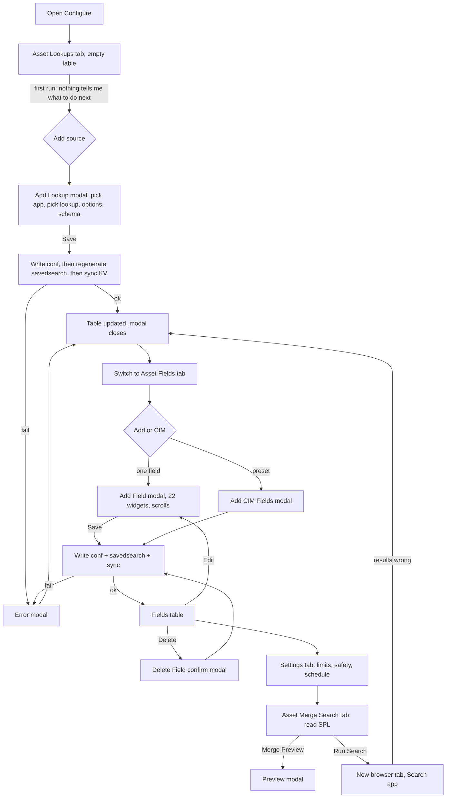
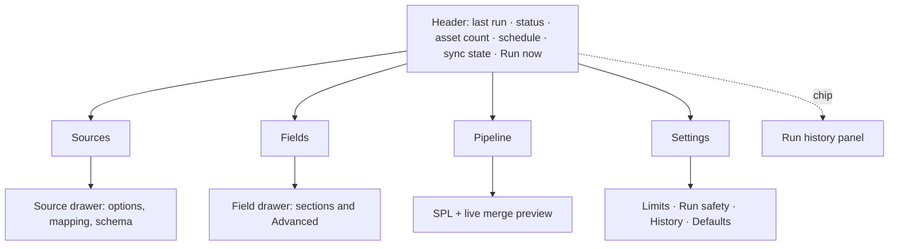

# AssetDB Configure UI: Stage 0 flow, layout and information architecture review

Status: **Stage 0 approved** (decisions recorded at the end of this file). Original status: deliverable for approval. No production file was changed. Stage 1 (visual design) and Stage 2 (implementation) have not been started.

Evidence base: a read-through of `assetdb.js`, `modal.js`, the input widgets, `assetdb.css` and `configure.xml`, plus Playwright probes of the running dev server. Click and scroll counts below are **estimates derived from the structure of the UI, not stopwatch measurements**. Where a number came from a probe it is marked *(probed)*. The 800px probe did not complete (the page holds several hidden `.modal` nodes and the locator picked a hidden one), so narrow-width findings come from the CSS (fixed 940px container), not from a measurement.

Hard constraint carried through every recommendation: **what is written to `assetdb.conf` and to the `assetdb-lookupgen` saved search does not change.** Everything here is presentation, flow and state handling.

---

## A. Inventory and current experience

### A1. Screens, panels and overlays

| # | Surface | Kind | User goal |
|---|---|---|---|
| 1 | Asset Lookups tab (landing) | tab | See which source lookups feed the asset DB; add, edit, remove sources |
| 2 | Asset Fields tab | tab | See which fields are merged and how; add, edit, remove fields |
| 3 | Asset Merge Search tab | tab | Read the generated SPL; open it in Search |
| 4 | Settings tab | tab | Global limits, key blocklist, ignore list, run safety, history, schedule, defaults; see recent runs |
| 5 | Recent runs table | panel at the bottom of Settings | Did the last build work and how big was it |
| 6 | Add Lookup | wide modal | Pick app + lookup, set role/scope/age/filter/mapping, see schema |
| 7 | Edit Source | modal | Change the same options on an existing source |
| 8 | Delete Lookup | modal (confirm) | Remove a source |
| 9 | Add / Edit Field | wide modal, 22 input widgets *(probed)* | Define a field and its merge, normaliser, validation and key behaviour |
| 10 | Delete Field | modal (confirm) | Remove a field |
| 11 | Add CIM Fields | modal | Add a preset set of fields in one go |
| 12 | Merge Preview | modal | See what the merge would produce before committing |
| 13 | Error | modal | Learn that a conf or saved-search write failed |
| 14 | Row actions "Edit \| Delete" | inline anchors | Act on one source or field |
| 15 | Run Search | button, opens a new browser tab | Run the generated search in the Search app |

Not present: any status header, any view of overflow keys, change history or conflict flags (the Review dashboard that showed them was removed), any reordering, duplicate, bulk or search control.

### A2. Current flow (as built)



Recover from an error: the Error modal reports the failure and closes to the same tab. The user has to work out which of the chained writes (conf, saved search, KV sync) failed and whether the saved search is now stale. Nothing on screen says so afterwards.

### A3. Top six tasks: cost estimate

Counts are minimum happy-path interactions from page load, estimated from the structure.

| Task | Clicks | Context switches | Scroll | Where context is lost |
|---|---|---|---|---|
| 1. First run: add first source | 5-7 (Add, app dropdown, lookup dropdown, review options, Save) | 1 (modal over empty table) | Add Lookup modal is wide and tall, likely scrolls on 1280x720 | Empty table gives no hint; the user does not know fields come next |
| 2. Add a source with a column mapping | 7-10 | 1 | Modal scroll | Schema shows in the modal but the mapping is entered in another section of the same modal; no live result |
| 3. Add a field | 6-10 (tab, Add, name, merge method, a few options, Save) | 2 (tab switch, modal) | Modal body scrolls, 22 widgets *(probed)* | The generated SPL effect of each option is invisible until another tab is opened |
| 4. Edit a field property | 3-5 (tab, row Edit, change, Save) | 2 | Modal scroll to find the control | Identical "Edit \| Delete" anchors on every row; edit means reopening the entire 22-widget form |
| 5. Reorder a field | not possible | n/a | n/a | Order affects the output; user must delete and re-add |
| 6. Review the generated search and run it | 2-3 (tab, Run Search) | 2-3 (tab switch, **new browser tab**) | Long SPL scrolls the page | The SPL is two tabs away from where the change was made; the result of Run Search is in another app |
| 7. Check the last run | 2 (Settings tab, scroll to the bottom) | 1 | Settings section is long (14 widgets plus table) | Run status is the last thing on the least-visited tab |
| 8. Recover from a failed save | 2-3 (read modal, dismiss, retry) | 1 | none | No persistent record; state of the saved search unknown |

### A4. Accessibility and structure facts found (code and probes)

- Tabs are `<a href="#" class="tab-label">` inside `<li>` with a click handler: no `role=tablist/tab`, no `aria-selected`, no arrow-key support.
- Radio-style widgets are buttons with a **static** `aria-pressed="false"`; the active state is only a CSS class, so assistive tech never hears a change.
- Modal close button is `aria-hidden="true"`, and the modal markup is Bootstrap-2 style without a verified `role="dialog"`/`aria-modal`/`aria-labelledby` or focus trap.
- Row Edit/Delete are identical text links with no row context in the accessible name.
- Container is a fixed 940px *(probed)*: at 1920px about half the viewport is empty, below ~940px it overflows.
- Errors appear only in a modal, never in a live region.

### A5. Primary user and jobs-to-be-done

**Primary user:** a Splunk admin or detection engineer. They set the app up once (one to a few sessions), then return occasionally to add a source, tune a field, or work out why last night's run looks off. They know SPL and lookups; they do not know this app's vocabulary (key, role, scope, overflow) from memory on the second visit.

| Frequency | Job | Today |
|---|---|---|
| **Frequent (after setup)** | Is the asset DB healthy? (last run, count, errors) | Buried at the bottom of Settings |
| **Frequent** | Add a source lookup | OK, but the modal is heavy |
| **Frequent** | Tweak one property on a field or source | Reopens the whole form |
| **Frequent** | Confirm the change produced the SPL I expect | Two tabs away, no live link |
| Rare | First-time setup | No guidance |
| Rare | Global limits, blocklist, safety switches | Settings tab, fine as is |
| Rare | Add the CIM preset | Modal, fine as a one-off |
| Rare | Delete a source or field | Confirm modal; should be undoable |

Optimization target: **health at a glance plus fast add/tweak/verify**. First-run guidance matters but must not become a permanent wizard.

---

## B. Modal audit

Rules applied: modals only for short interrupting decisions; use inline/drawer when surrounding context or the live SPL is needed or the task repeats; flatten chains; prefer immediate apply with undo over confirm/cancel.

| Modal | Recommendation | Why | Tradeoffs | Keyboard / focus / Escape |
|---|---|---|---|---|
| **Add / Edit Field** (22 widgets) | **Side drawer with sections** (Identity, Merge, Normalise, Validate, Advanced), opened from a row, beside a live "this field adds to the SPL" preview | Repeated task, long form, needs context and the SPL effect | Drawer is wide on small screens (becomes full-width sheet under ~900px). Split into sections means more structure to build | Focus moves to the drawer heading; Tab is trapped only if modal-like; Escape closes and keeps edits applied; focus returns to the row's Edit button; section headings are real `h3` and links in a mini-nav |
| **Edit Source** | **Same drawer pattern** as Field | Same repeat-edit task | Shared component keeps it cheap | As above |
| **Add Lookup** | **Drawer with a single searchable picker** (app + lookup merged into one combobox) and a schema preview; options below | Removes the two-dropdown dance, keeps the schema beside the choices | The picker needs search over all apps' lookups; keep a plain `select` fallback | Combobox with arrow keys and `aria-activedescendant`; Escape closes the list first, then the drawer |
| **Delete Lookup / Delete Field** | **Remove immediately, show an undo snackbar** (about 8 s, also in a live region) | A confirm modal for a reversible config edit is friction | Undo must re-write the conf, so it is a second write. Keep a confirm only if a source is referenced by a field mapping | Snackbar is a `role=status` with an Undo button reachable by Tab; focus moves to the next row; no focus trap |
| **Add CIM Fields** | **Empty-state card and an "Add preset" menu** in the Fields toolbar; apply immediately with undo | One-off, no decision needed beyond "which preset" | Hidden after first use, so keep a menu entry | Menu button with arrow keys; Escape closes |
| **Merge Preview** | **Inline Pipeline panel** (not a modal), updating live | Needs surrounding context; today the user closes it to change something and reopens it | Preview runs a search, so debounce and show "stale" state rather than rerun on each keystroke | Region labelled "Pipeline preview"; results announced politely, never steals focus |
| **Error** | **Persistent banner plus live region** at the top of the page | A modal that loses the error after dismiss is the worst partial-failure UX | Banner must be dismissible and not stack | `role=alert`; "Retry" and "Details" buttons; focus stays where it was |

Outcome: **zero blocking modals** except an optional confirm on removing a source that fields depend on. No modal opens another modal.

---

## C. Layout and structure review

### C1. Tabs, a single page, or a stepper

Today: four equal tabs and no status; the landing tab (Lookups) is neither the most useful nor a clear first step.

Recommendation: **persistent layout, not a stepper.** A stepper helps once and annoys on every later visit. Use:

1. a **persistent header** (status region),
2. **tabs: Sources, Fields, Pipeline, Settings** (renamed to match the user's vocabulary; "Asset Merge Search" becomes "Pipeline"),
3. a **first-run checklist card** that appears only while the state is incomplete (no source, no field, never ran) and removes itself afterwards. This gives stepper guidance without a stepper.

### C2. Generated SPL and merge preview

Today: separate tab plus a modal. Proposed: the **Pipeline tab** holds the SPL (syntax-highlighted, copyable, with a "N lines, N sources, N fields" summary) and the merge preview, both reading the same state. The Fields and Sources drawers show a small *"affects: lines 14-22"* hint linking to the Pipeline tab. A live update is **debounced and marked "out of date" until regenerated**, because regeneration writes the saved search; the preview itself is pure (`generator.js`) and can update on every change.

### C3. Persistent status / header region

Always visible above the tabs:

`Last run 03:10 · ok · 41,872 assets · schedule: daily 03:00 · config synced · [Run now] [Open in Search]`

States: **ok / warning (run safety triggered) / failed / never run / config out of sync**. Data source is the same `assetdb_runs` record already read for the Settings table. "Run now" dispatches the saved search (needs an endpoint already available through the REST handler; to be confirmed in Stage 2, see open questions). Clicking the chip opens the run history.

### C4. Save model

Current model: every dialog Save writes conf, then regenerates the savedsearch, then syncs KV, with the failure visible only as a modal.

Options considered:

| Model | Fit |
|---|---|
| Explicit Save for the whole page | Wrong. Rows are independent and the chain writes on each change anyway |
| Draft and publish | Heavy, and the saved search is only a derived artifact |
| **Immediate apply per change with an explicit state, plus undo for destructive actions** | **Recommended** |

Why: it matches existing behaviour (each change already writes), so no conf semantic changes. The UI problem is only that partial failure is invisible. Make the chain's progress visible per change:

| State | Shown as |
|---|---|
| Saved | Header: "All changes saved" |
| Saving | Spinner and "Saving…", controls in the drawer stay editable but Save is disabled |
| Failed (conf) | Banner: "Could not save. Nothing changed." with Retry |
| Failed (savedsearch) | Banner: "Config saved but the search was not updated. The scheduled run will use the old search." with **Regenerate search** (retries only the second step) |
| Failed (KV sync) | Banner: "Saved. Field types are out of sync." with Retry sync |

Partial failure is the key case: the conf write succeeds, the saved-search write fails. The user must know the *search is stale*, and a retry must redo only the failed step. This is a UI state change only; the order and content of the writes stay as is.

### C5. Field list

| Aspect | Recommendation |
|---|---|
| Table vs cards | **Dense table** (a dozen to fifty fields); cards waste vertical space |
| Grouping | **Keys first** (the fields that define identity), then the others, each with a header |
| Inline toggles | Enabled / key as switches; merge method as a small select in the row |
| Search / filter | Text filter and chips: key, has validation, uses normaliser |
| Reorder | **Drag handle plus Move up / Move down buttons** (keyboard path). Needs a decision, see open questions: order is stored in the conf today |
| Duplicate | Row menu "Duplicate" |
| Bulk | Multi-select with enable/disable/delete (delete with undo) |
| Templates / presets | CIM presets in the toolbar menu; "Add from template" later |
| Row actions | Row menu (⋯) with named items, each with an accessible name that includes the field |

### C6. Navigation

Configure is the only entry point, and the app nav is just Search and Configure. Recommendation: keep it as a **single page**, and if the removed dashboards are not coming back, make the header status the "home". Run history, overflow and changes need a place. See open questions.

### C7. Progressive disclosure

The field form has 22 widgets, most of which are defaults for most users. Default view per section shows the 4-6 controls used most (name, source column mapping, merge method, key); the rest sit under **Advanced** per section (normaliser, validation, ignore entries, allowed sources, value type, description). Settings: group into *Limits*, *Run safety*, *History*, *Defaults*, with a "Show advanced" for the key blocklist and ignore values.

### C8. Copy, labels, empty states, validation, destructive wording

- Rename tabs: Asset Lookups → **Sources**, Asset Fields → **Fields**, Asset Merge Search → **Pipeline**.
- Empty Sources: "No sources yet. A source is a lookup of assets (hosts, DHCP, vulnerabilities). [Add source] [Start from a template]".
- Empty Fields: "No fields yet. [Add CIM preset] [Add field]".
- Validation inline, on blur and on save, next to the control, tied with `aria-describedby`; messages say how to fix ("Field names cannot start with an underscore: Splunk treats those as internal").
- Destructive wording: "Remove source 'ad_users'" instead of "Delete"; no "Are you sure?"; the snackbar says "Removed 'ad_users'. Undo".
- Error copy states what happened and what state the system is in ("Saved, but the merge search was not updated").

### C9. Accessibility of the flow

- Tabs get `role=tablist/tab/tabpanel`, `aria-selected`, roving tabindex and arrow keys.
- Radio-like buttons become real `radiogroup`/`radio` or toggle buttons with a **live** `aria-pressed`.
- Drawer: `role=dialog` (non-modal) or `complementary`, labelled by its heading, focus on open, return on close.
- Live region for save state and errors; do not rely on colour alone for state.
- Landmarks: header (`banner`-like region), `main` for the tab panels, `complementary` for the drawer.
- Tab order follows visual order; no positive tabindex.
- Shortcuts (optional, discoverable, never required): `/` focus filter, `n` add, `Esc` close drawer.
- WCAG AA contrast and visible focus are Stage 1 tokens; the structure here does not depend on them.

### C10. Responsiveness

| Width | Current | Target |
|---|---|---|
| 1920px | Fixed 940px container, large empty margin *(probed)* | Fluid up to about 1400px; table plus a persistent drawer side by side |
| 1280px | Works, modals tall | Table plus drawer side by side |
| Under ~900px / embedded | Horizontal overflow | Single column, drawer becomes a full-width sheet, table collapses to stacked rows, header chip wraps |

---

## D. Deliverable

### D1. Prioritized changes (impact vs effort)

| # | Change | Impact | Effort | Priority |
|---|---|---|---|---|
| 1 | Persistent status header and run chip | High | M | **Do first** |
| 2 | Save-state model with partial-failure banner and per-step retry | High | M | **Do first** |
| 3 | Replace confirm modals with immediate remove plus undo snackbar | High | S | **Do first** |
| 4 | Fix accessibility basics (tab roles, live `aria-pressed`, dialog roles, row action names, fluid container) | High | S-M | **Do first** |
| 5 | Field/Source editor as a drawer with sections and Advanced | High | L | Next |
| 6 | Pipeline tab: SPL and live preview inline, flatten the preview modal | High | M | Next |
| 7 | Field table: group keys, search, inline toggles, row menu | Medium | M | Next |
| 8 | Field reorder and duplicate | Medium | M | Next (needs a decision) |
| 9 | First-run checklist and empty states | Medium | S | Next |
| 10 | Add Lookup single picker | Medium | M | Later |
| 11 | Bulk actions, shortcuts | Low-Med | M | Later |
| 12 | Run history / overflow / changes views | Medium | M-L | Depends on open question 1 |

### D2. Target information architecture



Wireframe (1280px):

```
+----------------------------------------------------------------------------------+
| AssetDB   Last run 03:10 ok · 41,872 assets · daily 03:00 · saved   [Run now]    |
+----------------------------------------------------------------------------------+
| Sources | Fields | Pipeline | Settings                                           |
+------------------------------------------------------+---------------------------+
| Filter [______]  [+ Add field]  [Presets v]          |  Field: hostname      [x] |
|                                                      |  Identity   Merge  Adv v  |
| KEYS                                                 |  Name  [hostname_______]  |
|  ⠿ hostname   key   coalesce   on   ⋯                |  Key   [on]               |
|  ⠿ ip         key   latest     on   ⋯                |  Merge [latest v]         |
| OTHER                                                |  ----                     |
|  ⠿ os         -     latest     on   ⋯                |  Affects pipeline lines   |
|  ⠿ owner      -     coalesce   on   ⋯                |  14-22  → Pipeline        |
+------------------------------------------------------+---------------------------+
| ✔ All changes saved                           Removed 'owner'.  [Undo]           |
+----------------------------------------------------------------------------------+
```

### D3. Before / after for the top tasks

| Task | Before | After |
|---|---|---|
| Add first source | Empty table, Add, modal with two dropdowns (about 6 clicks) | Checklist card "Step 1 of 3", Add, one picker with schema (about 4 clicks) |
| Add a field | Tab, Add, 22-widget modal, Save (about 8 clicks, scroll) | Add, drawer shows 5 essentials, Advanced collapsed, applies on blur or Save (about 5 clicks, little scroll) |
| Edit one field property | Tab, Edit, modal, change, Save (about 4 clicks, 2 context switches) | Click row, change in drawer or inline toggle (about 2 clicks, 0 switches) |
| Reorder a field | Delete and re-add (about 10 clicks) | Drag or Alt+Up/Down (1 action) |
| Verify generated SPL | Tab, optional preview modal, Run Search in a new tab (3 switches) | Pipeline tab alongside; the drawer links to the lines it affects (1 switch) |
| Check last run | Settings tab, scroll to table (2 clicks, scroll) | Always in the header (0 clicks) |
| Recover from a failed save | Error modal, dismiss, guess (unknown state) | Banner names which step failed, Retry only that step (1 click) |

### D4. Open questions (decisions needed before Stage 1)

1. **Run history, overflow keys, change history and conflicts:** the Review dashboard that showed them was removed. Do you want a read-only **Status** area inside Configure (my recommendation, small), nothing at all, or a returning dashboard later?
2. **Field order:** is it acceptable to add a reorder control, given that order is stored in the conf today? Does the existing order have meaning to the generated search that I should preserve (I believe merge order does not, but I want your confirmation before it becomes a visible feature).
3. **"Run now":** may the header dispatch the `assetdb-lookupgen` saved search (a new capability, no conf change)? Or keep to "Open in Search" only?
4. **Immediate apply with undo vs an explicit Save in the drawer:** I recommend immediate. Do you want a Save button anyway for peace of mind?
5. **Confirm on removing a source that fields depend on:** keep that one confirm, or treat it like every other remove?
6. **Tab names:** are Sources / Fields / Pipeline / Settings acceptable, or do you prefer to keep the current names?
7. **Narrow/embedded widths:** is Configure ever embedded in another page or a panel narrower than 900px, or is that only a safety net?
8. **First-run checklist:** acceptable as a self-dismissing card, or do you want a true wizard for the first run?
9. **Help text:** inline short hints only, or a "?" side panel with longer docs?

---

**Stopping here for your decisions.** Stage 1 will not start until you approve this review.


---

## E. Decisions (recorded after review)

| # | Question | Decision |
|---|---|---|
| 1 | Status area for run history, overflow and changes | Yes, inside Configure (header chip opens it) |
| 2 | Field reordering | **Dropped.** Order is effectively alphabetical (stanzas come back from REST by name), it is almost entirely cosmetic, and persisting a user order would need a new `order` setting in `assetdb.conf`. The table sorts by name with keys grouped first |
| 3 | "Run now" in the header | Yes |
| 4 | Save model | Immediate apply |
| 5 | Confirm when removing a source that fields depend on | Yes (the only remaining modal) |
| 6 | Tab names | Sources / Fields / Pipeline / Settings |
| 7 | Embedded below 900px | No |
| 8 | First-run guidance | Self-dismissing checklist is enough |
| 9 | Help text | Inline only |
